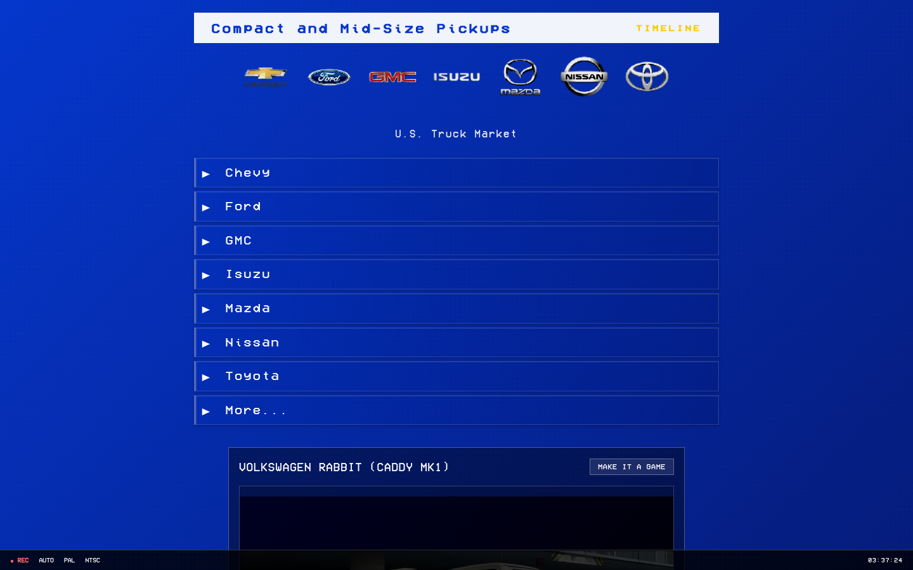

# Compact Pickup

A catalog of compact and mid-size pickup trucks sold in the U.S., styled like an old VHS recording. It started as a React class project and grew into a full Next.js app with a CMS.

Live at [compactpickup.com](https://compactpickup.com).



## What it does

- The home page is a manufacturer menu (Chevy, Ford, GMC, Isuzu, Mazda, Nissan, Toyota and more) with an image carousel and a running clock in the VHS-style status bar.
- `/[manufacturer]` lists a maker's trucks and `/[manufacturer]/[model]` shows a single model.
- `/timeline` walks through the models by year.
- `/browse` lets you search and filter trucks by year, drivetrain, engine and market.
- `/game` is "Name that truck": ten stills, four choices each.
- Model pages include a 3D model viewer built with React Three Fiber.
- Manufacturers and truck models are stored in Sanity. The studio is embedded at `/studio` (config in `sanity/`).

## Stack

Next.js 16, React 19, TypeScript, Tailwind CSS 4, Sanity, React Three Fiber and drei, deployed on Vercel.

## Running it locally

```sh
npm install
npm run dev
```

Open http://localhost:3000. The Sanity project id and dataset are set in `src/lib/sanity.ts` and the data is public, so the public site runs without any environment variables.

The binder (photo library at `/binder`, not linked in the nav) needs the variables in `.env.example`. `/admin` redirects to `/studio`. Sign-in allows only `ADMIN_EMAIL` via a one-time email code. The signed-in page is the review dashboard: pending, approved, and rejected photos, bulk approve or reject, upload, a coverage list, and a Sanity import. Approving a photo builds its fingerprint in your browser. Rejected photos stay in the library. A folder import takes each truck from the Sanity slug and ignores a truck id written in the manifest.

Migrations and imports use the direct Neon URL and stay a dry run until `BINDER_CONFIRM=1`:

```sh
npm run db:migrate
BINDER_CONFIRM=1 npm run db:migrate
npm run import:sanity
BINDER_CONFIRM=1 npm run import:sanity
npm run import:folder -- ./path/to/folder
npm run seed:faces
```

To work on content locally, use the site at `/studio` (`npm run dev`) or run `npm run studio:dev` for a standalone dev server. Other scripts are `npm run build`, `npm run start` and `npm run lint`.

## Layout

```
src/app/(site)/       pages (home, [manufacturer], timeline, browse, game)
src/app/binder/       review dashboard (sign-in, approve, upload, coverage)
src/app/api/          catalog API, auth, admin review routes
src/components/       ImageCarousel and the 3D truck viewer
src/lib/sanity.ts     Sanity client and queries
src/lib/binder/       database, R2, image compress, session
src/lib/clip/         shared browser fingerprint
db/migrations/        binder SQL
data/truck-faces.json optional face labels
scripts/              migrate, import, seed
sanity/               studio and schemas
```
